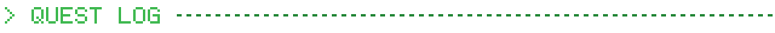
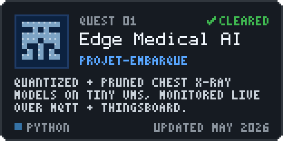
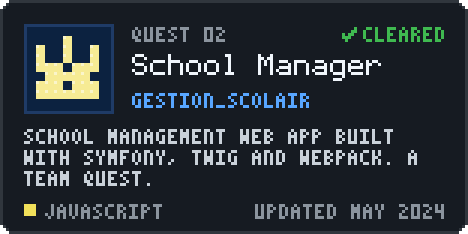

<!--
  Every image in assets/ is drawn pixel by pixel by scripts/generate.py from live
  GitHub data, and refreshed 4x a day by .github/workflows/pixel-profile.yml.
  Edit profile.json to change the texts, the inventory or the featured quests.
  The inventory and quests blocks below (between their start/end markers) are
  rewritten by the script on every run.
-->

  

  The window shows the sky over Tétouan right now · the monitor types my latest commits · one book on the shelf per language I write · the stop sign wears an adversarial patch.

  

  

<!-- inventory:start -->

  

<!-- inventory:end -->

  

<!-- quests:start -->

  
  

<!-- quests:end -->

  

  

  Every pixel above is drawn by <a href="scripts/generate.py"><code>scripts/generate.py</code></a> and repainted by GitHub Actions at dawn, noon, dusk and night.

